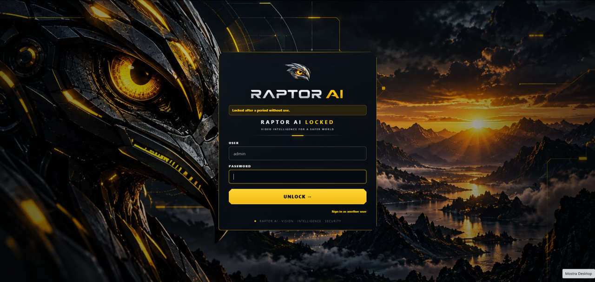
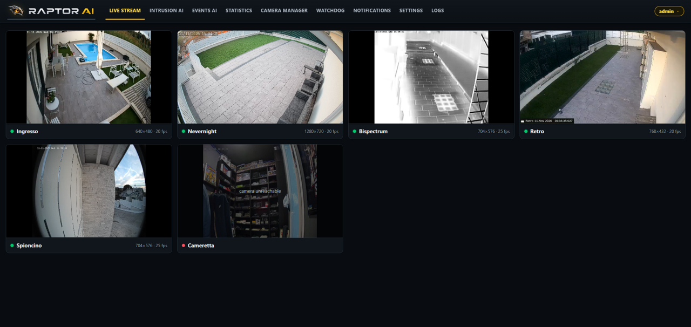
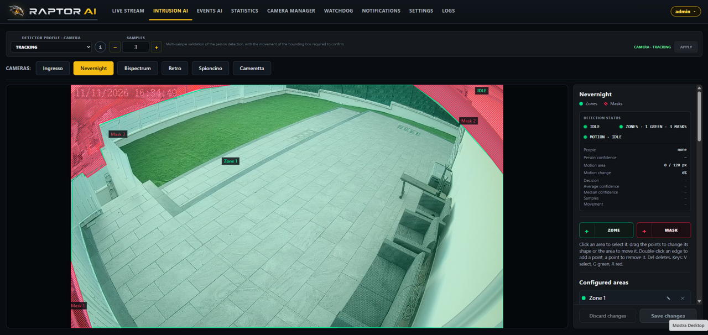
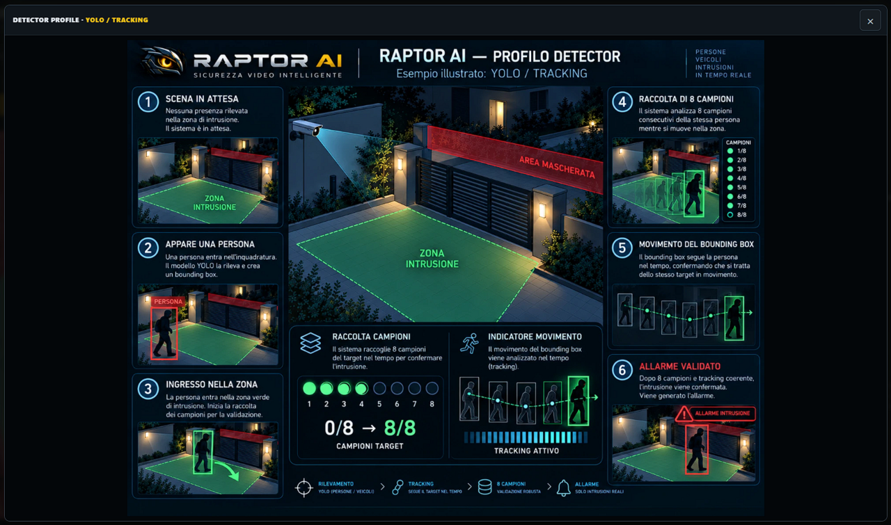
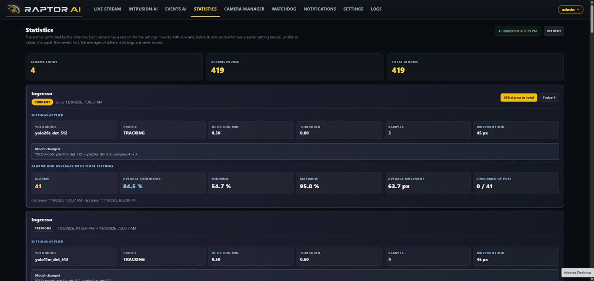
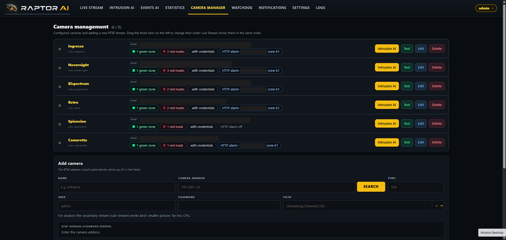

<p align="center">
  <a href="https://github.com/ultralytics/ultralytics"></a>
</p>

<p align="center">
  
</p>

# Raptor AI — Orange Pi 4 Pro

Smart-detection video surveillance system, NPU-accelerated, for the Orange Pi 4 Pro board. Local processing, no cloud: cameras in, confirmed intrusion alerts out.

## Features

**Live Stream** — all your cameras in one view, live.



**Intrusion AI** — zone-based detection with multi-sample confirmation and movement tracking, so a stray shadow or a passing cat doesn't trigger a false alarm.





**Statistics** — alarm history and detector performance, per camera, over time.



**Camera Manager** — add, test and configure every RTSP camera from one screen.



Also included: Events AI, a Watchdog that reports when a camera goes offline, Telegram/e-mail notifications, and a GPIO-based alarm relay — all configured from the same panel.

## Prerequisites

| | |
|---|---|
| **Board** | Orange Pi 4 Pro |
| **OS image** | Debian 12 "Bookworm", our image version 1.08 — flash this before anything else |
| **Kernel** | the vendor BSP kernel that ships with that image (reports itself as `sun60iw2`) |
| **Memory** | at least 3.5 GB RAM |
| **Storage** | at least 3 GB free (8 GB+ recommended — event recordings grow over time) |
| **Storage media** | highly recommended: an NVMe SSD, PCIe Gen3x4 (e.g. fanxiang S501 128 GB) — a microSD works too, Class V30 minimum, V60 recommended |
| **NPU** | driver and libraries already present in our image |
| **Network** | internet access to download the installer; not required to use the 30-day trial below, only later if you activate a paid licence |

Don't have our image yet, or not sure which version you have? Flash it first — installing on anything else isn't supported and the check below will stop you.

## Installation

On a freshly powered-on board, running the OS image we provide, as the `orangepi` user (no root needed): one command.

```
curl -fsSL https://raw.githubusercontent.com/Federiko78/Raptor-Ai-OrangePi4Pro-Ver.0.16.10/main/raptor-install-check.sh | bash
```

This checks that the board is ready — OS, kernel, memory, free space, NPU, network — and tells you whether you can proceed. It makes no changes and installs nothing. The full guided installation follows once the check passes.

## Licensing

The first time you create the admin account in the panel, Raptor AI starts a **30-day free trial** on its own — no internet connection, activation code, or contact with us required. The trial gives you:

- 1 camera
- the STANDARD-tier features (Live Stream, Intrusion AI, Events AI, Camera Manager, the GPIO alarm relay)

A banner in the panel shows how many days are left. When the trial ends, or whenever you're ready for more cameras or the higher tiers (Statistics, Watchdog, Camera Manager's network search, Telegram/e-mail notifications, Logs), activate a paid licence from the same panel — that step does need an internet connection, to reach our licensing server.
